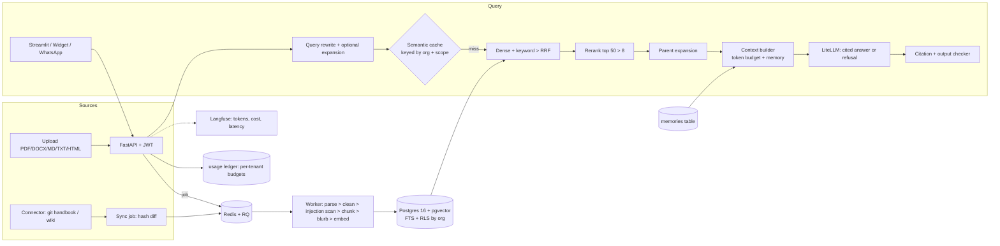

# P02 Production RAG Platform: PLAN

## Context
P02 is the second portfolio project: a multi-tenant document Q&A platform with cited answers, hybrid retrieval, per-user
memory, strict tenant isolation, and web / widget / WhatsApp channels.
Revised 2026-09-30 after Phase 0 and the first Phase 1 tasks (see "Revisions" at the end).

**Decisions taken (2026-09-30):**
- GraphRAG: small comparison slice only (one handbook section, about 20 relationship questions). P10 does the depth.
- UI: Streamlit for chat + admin (retrieval inspector, ingestion status, chunk previews). The widget is a vanilla-JS
  single `<script>` bundle. Next.js is not needed for it; I propose a static demo page instead and will confirm.
- Reranker: local bge-reranker; Cohere is benchmarked on the same eval for ADR 003.
- Models via LiteLLM: Claude Haiku 4.5 for answers, rewrites, blurbs, memory extraction; Sonnet 5.5 as judge.
  Embeddings: one local open model plus one hosted model for the quality-vs-cost experiment. Anthropic has no
  embedding model. Verify current model names and prices when writing ADR 006. The embedding model must fit
  pgvector's index limit (`vector` up to 2,000 dimensions, `halfvec` up to 4,000).
- Corpus: LLM-costly steps (contextual blurbs, eval drafting, judge runs) use a **Tenant A slice**; the full GitLab
  handbook is ingested without blurbs as a scale test (see Data).
- API spend: a **cost guard** on every script that calls a model (see Cost budget). Top up credit only when needed.
- One release at the end (no interim v1-core milestone).

**Schedule warning:** the master plan had P02 on Sep 26-27; it is now Sep 30, and the scope has grown by 7 concept
groups plus 5 coverage gaps. Estimates (next step) must show this honestly. If a phase passes 130% of plan, the
order to move work to the end of P02 (not out of it) is: agentic RAG, RAPTOR, GraphRAG slice, WhatsApp.

## Architecture (Mermaid, goes in docs/architecture.mmd)

## Schema (Postgres, ports: PG 5434, Redis 6380, API 8001, UI 8502)
Roles: `rag_owner` (migrations), `rag_app` and `rag_worker` (no BYPASSRLS, `FORCE ROW LEVEL SECURITY`).
Every request/job runs `SET LOCAL app.org_id, app.user_id` taken from the verified JWT or the job payload, never
from the body or the model. `SET LOCAL` (or `set_config(..., true)`) only lasts for the current transaction, so a
pooled connection can never carry one tenant's setting into the next request; a test proves this with a pool.
If no org is set, policies must match nothing (fail closed), never everything.

| Table | Key columns |
|---|---|
| orgs, users | org_id, email, role (admin/member) |
| documents | org_id, owner_id, visibility (private / org / public), source_type, source_uri, content_hash, active_version, status, source_updated_at |
| chunks | org_id, owner_id + visibility (copied from doc so RLS needs no join), document_id, version, level (0 child, 1 parent, 2 summary), parent_id, page_start/end, section_path, text, context_blurb, embedding, tsv, content_hash. Composite FK (document_id, org_id) |
| conversations, messages | org_id, user_id, rewritten_query, citations |
| memories | org_id, user_id, fact, embedding, source_message_id (separate from chunks) |
| ingestion_jobs | status, error, idempotency key = org + content_hash |
| usage_ledger | org_id, user_id, day, tokens, cost (budget caps and alerts) |
| feedback, leads, audit_log, semantic_cache | cache keyed by org + visibility scope + doc versions |

RLS on chunks: `org_id = current_setting('app.org_id')::uuid AND (visibility='org' OR owner_id = current_setting('app.user_id')::uuid)`,
plus `WITH CHECK` on writes. HNSW + filter can return fewer than N rows: test pgvector iterative scans, and compare
with exact search for small tenants (filter first, no HNSW).
**Anonymous channels:** widget and WhatsApp visitors are not org members. They get a separate `anonymous` scope that
sees only `visibility = 'public'` documents, never org-internal ones (migration in Phase 4, with leak tests).

## API (FastAPI)
- Auth: `POST /auth/login`
- Documents: `POST /documents`, `GET /documents`, `GET /documents/{id}`, `DELETE`, `POST /documents/{id}/reindex`, `GET /jobs/{id}`
- Chat: `POST /chat` (SSE stream), `GET /conversations`, `GET /conversations/{id}`
- Memory: `GET /memories`, `DELETE /memories/{id}`
- Feedback / leads: `POST /feedback`, `POST /leads` (handoff flag on the conversation)
- Admin: `POST /admin/inspect` (candidates with dense, keyword, RRF, rerank scores), `GET /admin/chunks`, `GET /admin/usage`
- Connectors: `POST /connectors`, `POST /connectors/{id}/sync`
- Channels: `POST /widget/chat` (public site key maps to an org), `POST /channels/whatsapp/webhook` (Twilio signature check)

## Ingestion pipeline (worker, RQ chosen over Celery for simplicity)
upload validation (type, size, magic bytes) > store raw > job > parse with page numbers (PyMuPDF, python-docx, markdown, HTML)
> preprocess (boilerplate/nav removal, table handling, chunk-level dedupe, OCR only if a scanned PDF is in the corpus)
> injection scan (hidden text, instruction-like phrases, flagged not silently dropped) > chunk (A: recursive by tokens;
B: heading-aware; parent-child) > contextual blurb (Haiku + prompt caching) > embed > write new version in one
transaction, then flip `active_version` and delete the old chunks (versioned re-index). Status is visible per job.

## Retrieval pipeline (every stage is a setting so the eval can toggle it)
rewrite (only with history) > optional multi-query / HyDE > cache lookup > dense top 50 + keyword top 50 > RRF (k, weights)
(keyword query = OR of the question's words via `websearch_to_tsquery`-style parsing; strict AND returns too little.
`ts_rank` is not BM25: compare `ts_rank_cd` with a true-BM25 extension in ADR 003)
> rerank to 8 > parent expansion > context assembly under a token budget (+ memory in a separate delimited block)
> cited answer or refusal > checker (every citation id must be in the retrieved set; no external URLs/images).
Reranker on CPU is the biggest latency risk (a large cross-encoder can take seconds for 50 pairs): a 1 h spike in
Phase 2 measures it; knobs are candidate count (20-50), a smaller model, or ONNX.
Agentic mode is a separate path with a step cap and a token budget; tools inherit the org from the backend.

## Memory design
After each turn, async: Haiku proposes stable facts as JSON > Presidio redaction > merge/dedupe against existing by
similarity > store. Retrieved top 3 by similarity into a block labelled "user facts (may be wrong)". Users can list and
delete. Never written into the document index. RLS by user.
Traces: prompts contain document text and user messages, so PII is redacted before anything is sent to Langfuse.

## Phases and acceptance criteria
| # | Phase | Done means |
|---|---|---|
| 0 | Foundations: scaffold, compose, settings, LiteLLM + Langfuse, Makefile, CI skeleton, data licence check + download | `docker compose up` healthy on the new ports; one traced LLM call; licences recorded in `docs/data.md` |
| 1 | Ingestion + eval set v0 | 2 chunkers, HNSW + GIN, worker with status, dedupe, versioned re-index; qa.jsonl drafted (95 items, gold = doc + page, `reviewed` flag) |
| 2 | Retrieval + answers | 3 modes, RRF, rerank, streaming, citations, refusal, inspector endpoint; `make eval` prints Recall@5, MRR, nDCG@10 per mode |
| 3 | Tenancy, auth, memory, PII | JWT, RLS, private vs shared; memory view/delete; adversarial suite runs (forged tenant, modified doc ids, injected docs) with 0 leaks |
| 4 | Channels | Streamlit chat + admin, one-tag widget, WhatsApp sandbox, lead capture + handoff flag |
| 5 | Advanced retrieval | rewriting, multi-query/HyDE, parent-child + RAPTOR, GraphRAG slice, agentic mode, living-wiki connector with hash-diff sync and permission sync, 1-2 h LangChain/LangGraph spike (ADR 010), plus a library-chunker comparison (LangChain splitters vs ours, same slice and metrics) |
| 6 | Evaluate + optimize | brief experiments 1-7 plus: rewriting, expansion, hierarchical, GraphRAG, agentic, long-context vs RAG; 3+ logged optimizations; token budgets with alert; feedback loop into eval |
| 7 | Security pass | red-team (garak / promptfoo / PortSwigger patterns), attacks tried vs blocked; OWASP mapping; data-policy note; AI disclosure line |
| 8 | Package | README with tables and diagram, DEMO_SCRIPT, LEARNING_LOG, CI with a 15-question mocked eval, demo video |
| v2 | AWS | Terraform (VPC, ECS Fargate, RDS pgvector, ElastiCache, ALB + HTTPS, Secrets Manager, CloudWatch), CI/CD, k6 at 10/50 users, monthly cost note |

## Eval plan
- 80 answerable + 15 unanswerable. Gold is **(document, locator)**, not a chunk id, so chunking experiments stay
  comparable. Locator = page for PDF/DOCX, heading anchor for Markdown/HTML (handbooks have no pages).
  A retrieval hit means a retrieved chunk overlaps the gold page or section.
- The eval corpus is **pinned to a git commit** of each handbook, recorded in `evals/`. The living-wiki demo replays
  later commits separately, so wiki changes never silently break gold answers.
- Questions come from the Tenant A slice, PostHog and the PDFs; the 15 unanswerable ones are plausible but absent.
- Include relationship / multi-hop questions (for GraphRAG and agentic) and follow-ups (for rewriting) as tagged subsets.
- Candidates drafted by an LLM from the corpus, then reviewed by you; `reviewed: true` is recorded per item (P01 never did).
- Retrieval: Recall@5/50, MRR, nDCG@10 per mode. Answers: faithfulness and correctness by Sonnet judge calibrated on 20
  hand-labelled answers; refusal accuracy; p50/p95; cost per answer.
- Targets: Recall@5 >= 0.85 and +10 pts over dense; faithfulness >= 0.90; refusal >= 90%; 0 leaks; p95 first token < 2.5 s;
  cost per answer reported and >= 30% lower after caching/model choice.

## Cost / latency budget (p95 time to first token 2.5 s; to be confirmed by measurement)
embed query 0.1 s, rewrite 0.3 s (follow-ups only), retrieval 0.1 s, local rerank 0.3-0.5 s, first token 0.8-1.2 s.
Cost per answer is a baseline first; then caching, Haiku-only vs cascade, and context trimming.

**Project API budget (rough, to be replaced by measured numbers):** $10 credit available.
| Item | Rough cost |
|---|---|
| Contextual blurbs, Tenant A slice (~4.1k chunks at 400 tokens, measured in task 1.6) + PostHog (~1.5k) | $5-8 (less with prompt caching; replace with measured cost in task 1.9) |
| Eval set drafting | < $1 |
| Answer + judge runs, ~15 configurations x 95 questions | $10-15 |
| RAPTOR summaries, GraphRAG slice, agentic, long-context experiment | $3-8 |
| Total | ~$20-30, so a top-up is likely mid-Phase 6 |
**Cost guard:** every script that calls a model estimates tokens x price first, prints it, and needs `--yes` above
$0.50. Actual spend is read from Langfuse and logged per experiment in `docs/benchmarks.md`.

## ADRs (docs/adr/, 10 because scope is larger than the usual 3-5)
001 vector store (pgvector vs Qdrant vs Pinecone) - 002 chunking - 003 hybrid fusion + reranker (local vs Cohere) -
004 memory - 005 tenant isolation (filter vs RLS vs DB-per-tenant) - 006 LLM + embedding models - 007 query
rewriting/expansion - 008 hierarchical / GraphRAG / agentic - 009 connectors + incremental sync - 010 framework (LangChain) vs plain Python.

## KB check (AI_ENGINEERING_KB.md and IDEAS.md): what fits P02 and the cheapest way in
Already in scope and confirmed: long-context vs RAG (score 9), per-tenant budgets (8), feedback loop, red-team,
data-policy + Art. 50 line. Cheapest ways: long-context = same eval, whole-doc prompt on 1 model (~3 h);
budgets = LiteLLM budget/virtual keys or own ledger (~2.5 h); red-team = promptfoo config + 5 PortSwigger patterns.
Worth adding (each under half a day):
1. **Tenant-scoped semantic cache tests.** The KB lists this as a resource gap, so it is a portfolio opportunity: a test
   proving Tenant B never gets Tenant A's cached answer, and that cache keys use the rewritten question.
2. **Context compression / history compaction** (only a passing mention today): summarize old turns; measure quality with
   and without. Counts as one of the 3 optimizations.
3. **OWASP GenAI Top 10 (2026 edition) mapping** table in ADR 005: each risk to a control or test (~1 h).
4. **pgvector 0.8 iterative scans** check for filtered HNSW (from the KB's multi-tenant note).
Not for P02: A2A, computer-use, DSPy, online-eval canaries (P03/P04/P10 homes). Resources first: Lance Martin *RAG From
Scratch* (free, ~10 h; rewrite in plain Python), Anthropic contextual-retrieval post + cookbook (free, 3-4 h), Truto/tianpan
multi-tenant posts (free, ~1 h), OWASP LLM10 (free).

## Data (licences verified; details in docs/data.md)
- **Tenant A:** GitLab handbook slice = `people-group`, `people-policies`, `total-rewards`, `hiring`, `values`,
  `communication`, `leadership`, `finance` (~220 pages, 3,272 sections, ~0.6M tokens, ~4.1k chunks at 400 tokens). Chosen because PostHog covers the same topics
  (hiring, benefits, expenses, values), which makes cross-tenant leak tests meaningful. The full handbook (~4,200
  pages, ~10M tokens, ~21k chunks) is ingested **without blurbs** as a scale and latency test.
- **Tenant B:** PostHog `contents/handbook` only (MIT part of the repo; ~380 pages).
- **PDFs:** IRS Pub 15-B, IRS Pub 969, OPM FEHB overview (US federal works). DOL guides blocked scripted download.
- **DOCX:** a synthetic benefits-policy DOCX with tables, written by us.
- **Adversarial docs:** written by us (Phase 3).

## Verification of this plan (once code exists)
`make setup && docker compose up` healthy; `make test`; `make eval` prints all metrics; adversarial suite prints
"N attacks, 0 leaks"; demo script from the brief runs end to end; every phase ends with a real run, not just tests.

## Status
Phase 0 done (1.35 h). Phase 1 in progress (1.1 and 1.2 done).
Open item: widget host page. Proposed a static demo page instead of Next.js; confirm before Phase 4.

## Revisions
**2026-09-30 (after Phase 0 and tasks 1.1-1.2):**
- Tenant A slice + full-corpus scale test (cost: full-corpus blurbs would be ~$40-70).
- Cost budget table and cost guard.
- Eval gold uses a locator (page or heading) and a pinned corpus commit.
- `public` visibility + anonymous scope for widget/WhatsApp (they must not see org-internal docs).
- RLS settings are transaction-scoped and fail closed; pooled-connection leak test.
- Keyword search uses OR, and `ts_rank` vs BM25 goes into ADR 003 (from the task 1.1 reading).
- Reranker CPU latency spike in Phase 2; PII redacted before Langfuse; embedding dimension limit noted.
- Estimation: from Phase 1 on, estimate learning/Q&A and build separately (Phase 0 lesson).
