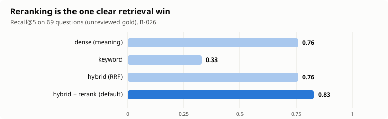
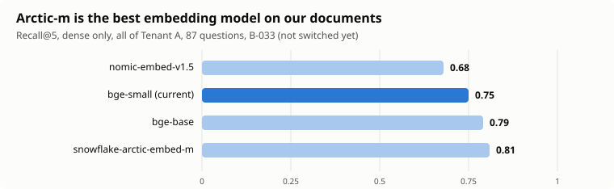
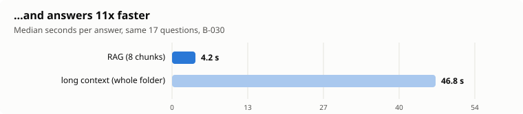

# P02 Production RAG Platform

> Multi-tenant document Q&A with cited answers, hybrid retrieval, per-user memory, strict tenant isolation,
> and web, website-widget and WhatsApp channels. **Work in progress** (Phases 0 to 6 built; this README gets its
> final form in Phase 8).

## Status

| Phase | What | State |
|---|---|---|
| 0 | Foundations (compose, settings, LiteLLM, Langfuse) | done |
| 1 | Ingestion pipeline, chunkers, contextual blurbs, eval set v0 | done (eval set drafted by an LLM, **not human-reviewed**) |
| 2 | Retrieval (dense, keyword, RRF, rerank), grounded cited answers, streaming, inspector, eval runner | done |
| 3 | Tenancy: row-level security, JWT login, private/shared documents, memory, PII redaction, injection defences | done (47 attacks, 0 leaks) |
| 4 | Channels: Streamlit chat + admin, embeddable widget, public documents, leads and human handoff, WhatsApp | done, **except the live WhatsApp run (on hold, see below)** |
| 5 | Advanced retrieval (query rewriting, HyDE, RAPTOR, GraphRAG slice, agentic RAG, connectors with incremental sync) | done (most features OFF by default after measurement) |
| 6 | Experiments, semantic cache, per-tenant budgets, feedback loop | done: see [`docs/phase6_results.md`](docs/phase6_results.md) |
| 7 | Security pass (red team) and data policy | not started |
| 8 | Packaging: README, demo video, CI | not started |

## What the experiments showed (informal: unreviewed LLM-drafted eval set)
Full table with decisions: [`docs/phase6_results.md`](docs/phase6_results.md). The three biggest effects were a heading-aware chunker,
a local reranker and query rewriting for follow-ups; most of the fancier retrieval (summary tree, GraphRAG, multi-query, long context)
did not beat the simple pipeline on these questions and is built but off by default.

## On hold: WhatsApp tested with a real phone (task 4.8)

**Decision (2026-10-07):** the live run of the WhatsApp channel through Twilio's sandbox is postponed until it is needed.

- **What exists and is tested:** the webhook (`POST /channels/whatsapp/webhook`) with Twilio signature verification
  (reproduces Twilio's documented example), reply formatting, routing by a keyed hash of the phone number (the number is
  never stored for routing), consent-gated human handoff, `STOP` erasure, per-phone rate limit and per-site daily
  budget, idempotency against Twilio redelivery, and a "webhook only" mode for safe tunnelling.
  23 + 6 automated tests, plus a live run with correctly signed requests against the real API, models and database.
- **What has NOT been verified:** a real message from a real phone through a real Twilio account and a public tunnel.
  Anything that only appears there (Twilio message format differences, delivery delays, sandbox expiry) is untested.
- **To resume** (about 25 minutes, free): follow [`docs/WHATSAPP_SETUP.md`](docs/WHATSAPP_SETUP.md); first run
  `uv run python -m scripts.whatsapp_preflight`, which checks everything that can be checked in advance.
- **Safety note:** never tunnel the API without `WEBHOOK_ONLY=true` (the demo accounts have weak passwords).

## Known limitations (so far)
- The eval set is LLM-drafted and was reviewed by Claude, not a human, on 2026-10-09 ([`docs/EVAL_REVIEW.md`](docs/EVAL_REVIEW.md)): 23% of the drafted questions had flaws and were fixed or dropped. Numbers measured before that review are not comparable with later ones.
- The ingestion scan for hidden instructions is regex-based (a smoke alarm, not a classifier).
- Memory merges near-duplicates only above 0.90 similarity, so a correction like "moved to Munich" can leave the old fact.
- The widget is tested in headless Chromium only; WhatsApp is not tested end to end (see above).

## Documentation map
`PLAN.md` (plan), `ESTIMATES.md` (estimates vs actuals), `docs/adr/` (decision records), `docs/benchmarks.md`
(every measurement), `docs/PHASE3_CODE_FLOW.md` (how login, tenancy, memory fit together), `docs/data.md` (data sources and licences).

## Problem / Solution / Results / Design decisions / Reliability / Quick start / What I'd do next
To be written in Phase 8 (task 8.1).
