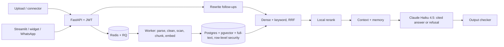
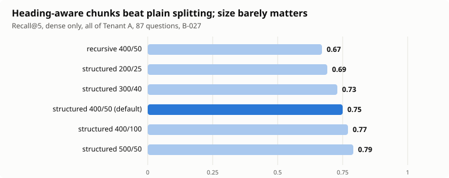
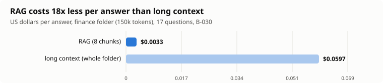

# P02 Production RAG Platform: cited answers from private documents, 0.95 faithfulness, 83 attacks and 0 breaches, 0.34 cents per answer

> Multi-tenant document Q&A: upload PDF / DOCX / Markdown / HTML, ask questions in a web app, a website widget or WhatsApp, and get answers that cite
> document and page, or an honest refusal. Companies are isolated by the database (row-level security), not by the prompt.
>
> ▶ Demo video: *(to add after recording; script in [`docs/DEMO_SCRIPT.md`](docs/DEMO_SCRIPT.md))*

## Problem
Company knowledge sits in handbooks, policies and PDFs that nobody can search well, and a chatbot that makes things up or shows one
customer another customer's data is worse than none. The hard parts are not the chat box: they are **finding the right passage**
(Recall), **saying "I don't know"** when the documents do not say, **keeping tenants apart**, **resisting hostile text**
inside uploaded files, and **knowing what each answer costs**.

## Solution

Full diagram: [`docs/architecture.mmd`](docs/architecture.mmd). Stack: Python 3.12, FastAPI, Postgres 16 + pgvector, Redis/RQ, LiteLLM (Claude Haiku 4.5 answers, Sonnet 5.5 judge),
local `bge-small` embeddings and MiniLM cross-encoder reranker, Streamlit, a one-file JS widget, Twilio WhatsApp, Langfuse tracing.

## Results
Measured on a **267-question eval set** over two public company handbooks and public HR/benefit documents (every item checked against its source by Claude, **not by a human**, see [`docs/EVAL_REVIEW.md`](docs/EVAL_REVIEW.md)).
The set is split into dev and test by hash; I tuned on dev and looked at the 101-question test split once. Differences under about 4 points are noise.

| Metric | Result | Where |
|---|---|---|
| Faithfulness (answer supported by its sources, Sonnet judge) | **0.954** (test) | B-038 |
| Correctness | 0.716 (test) / 0.822 (all 267, first reviewed baseline) | B-038, B-036 |
| Refusal on unanswerable near-miss questions | **0.962** (all) / 0.90 (test) | B-036, B-038 |
| Wrongly refused (answerable but refused) | 14.8% (test) | B-038 |
| Recall@5 / MRR, hybrid + rerank | **0.81 / 0.73** | B-036 |
| Cost per answer | **$0.0034** (0.34 cents) | B-036 |
| Latency p50 / p95 | 2.9-4.0 s / 4.0-5.0 s | B-036, B-026 |
| Red team | **83 attacks, 14 families, 0 breaches** | B-039, B-040 |
| Isolation suite | 47 attacks, 0 leaks | B-015 |

**Before to after** (set and benchmark noted, so differences are comparable only within a row):

| Change | Before | After | Cost / latency | Set |
|---|---|---|---|---|
| Local cross-encoder reranker | R@1 0.43, R@5 0.76 | **R@1 0.59, R@5 0.81** | about 1 s, $0 | reviewed (B-036) |
| Heading-aware chunker vs plain recursive | R@5 0.67 | **0.75** | none | earlier set (B-027) |
| Rewriting follow-ups with chat history | R@5 0.00 | **0.60** (0.76 on reviewed set) | $0.0005, only on follow-ups | B-019, B-036 |
| Incremental sync of a changing wiki | full rebuild | **30% of the embedding work, 33% of the time** | $0 | real handbook history (B-024) |
| Semantic cache hit (off by default) | about 4 s, 0.35 cents | **19 ms, $0**, 0 wrong hits at threshold 0.93 | | B-028 |
| RAG vs stuffing 150k tokens in the prompt | correctness 0.35-0.62 | **0.91** with RAG | 18x cheaper, 11x faster | B-030 |
| Per-org daily budget | 50-request runaway loop | stopped after 3 requests | | B-029 |

**Negative results, kept on purpose** (built, tested, OFF by default; none beat the simple pipeline beyond noise): multi-query and HyDE, parent expansion, summary tree,
GraphRAG slice (helped relationship questions +30 points, hurt broad ones -25), agentic retrieval, contextual blurbs (about $7 for +4 points), larger or different embedders and rerankers, a longer-answer prompt (+3.8 on dev, +0.6 on test: reverted).
Charts and every row: [`docs/phase6_results.md`](docs/phase6_results.md).




## Key design decisions
| ADR | Decision |
|---|---|
| [001](docs/adr/001-vector-store.md) | pgvector in Postgres (one database for vectors, text and row-level security), iterative scans for filtered HNSW |
| [002](docs/adr/002-chunking.md) | heading-aware chunker, 400 tokens, 50 overlap, page and anchor kept for citations |
| [003](docs/adr/003-hybrid-fusion-and-reranker.md) | hybrid RRF + local reranker; the reranker is the win, hybrid alone was not |
| [004](docs/adr/004-memory.md) | per-user memory, separate from chat history and from documents; viewable and deletable; personal data never stored |
| [005](docs/adr/005-tenant-isolation.md) | row-level security with a non-bypass role, tenant from the token only; OWASP GenAI Top 10 mapping |
| [006](docs/adr/006-llm-and-embedding-models.md) | Haiku 4.5 for answers, Sonnet judge, local embeddings (a better one measured but not switched) |
| [007](docs/adr/007-query-rewriting-and-expansion.md) | rewrite follow-ups ON; multi-query and HyDE OFF |
| [008](docs/adr/008-hierarchical-graph-agentic.md) | parents, summary tree, GraphRAG, agent built behind flags |
| [009](docs/adr/009-connectors-and-incremental-sync.md) | connector interface and fingerprint-based incremental sync |
| [010](docs/adr/010-framework-vs-plain-python.md) | plain Python over LangChain/LangGraph (spike: same answers, fewer places to look when it breaks) |
| [011](docs/adr/011-public-channels.md) | anonymous scope for the widget and WhatsApp: public documents only |
| [012](docs/adr/012-semantic-cache.md) | tenant-scoped, revalidated semantic cache, off by default |

## Reliability and safety
- **Isolation:** Postgres row-level security; the API refuses to start with a role that could bypass it; forged tenant ids, headers and tokens tested.
- **Injection:** hidden text removed before indexing, scan flags instruction-like content, sources are delimited and escaped, an output checker rejects images, foreign links and invented citations. Red team: 83 attacks (direct, indirect, multi-turn, encoded, hidden in uploads, exfiltration, cross-tenant, cache and memory poisoning), 0 breaches. [`docs/SECURITY_REVIEW.md`](docs/SECURITY_REVIEW.md)
- **Cost control:** per-org daily budget with alert, per-site budget, rate limits, answer length cap, spend guard on every paid script.
- **Failure handling:** timeouts, retries with backoff, transient-vs-permanent job failures, idempotent WhatsApp redelivery, graceful degradation without Redis.
- **Privacy:** [`docs/DATA_POLICY.md`](docs/DATA_POLICY.md): what is stored, retention (`make purge`: visitor chats 90 days, leads 365), what goes to third parties; every channel discloses "AI assistant" (EU AI Act Art. 50), tested.
- **Supply chain:** `uv.lock` pins every version; CI runs `pip-audit` (it found and we fixed 3 advisories in `cryptography`).

## Quick start
```bash
cp .env.example .env            # fill the passwords, JWT_SECRET (openssl rand -hex 32) and ANTHROPIC_API_KEY
make demo                       # builds the image, starts Postgres, Redis, API :8001, worker, UI :8502, creates a demo admin
# open http://localhost:8502 and log in as demo@demo.example / demo-password-123
```
The first build downloads all dependencies (about 25 minutes on a slow connection; later builds use the cache) and the first API start downloads the
embedding and reranker models (about 1.5 minutes). Verified from a fresh clone: login, upload, ingestion by the worker and a cited answer all work (`docker compose`, 2026-10-09).
Development without Docker for the app: `make setup && make up && make migrate`, then
`uv run uvicorn app.api.main:_default_app --factory --port 8001`, `uv run python -m app.worker`, `uv run streamlit run ui/Chat.py --server.port 8502`.

| Command | What it does |
|---|---|
| `make test` | all tests (needs `make up` for the database ones; no API key, no cost) |
| `make eval-ci` | the 15-question mocked eval CI runs (free) |
| `make eval` | the full eval, about $1.5-2.5 |
| `make adversarial` / `make redteam` | isolation suite / 83-attack campaign (about $0.11) |
| `make bench` | list every logged measurement |
| `make purge` | delete expired visitor data |
| `make demo-widget` | the embeddable widget on a demo customer site |

## Limitations
- **The eval set was reviewed by a model, not a human** (a human spot-check of about 10% is the obvious next step). Dev/test split and noise (about 4 points) apply to every comparison.
- Multi-hop and relationship questions remain weak (correct 13 of 23 and 4 of 18 in the first reviewed baseline); no technique tried beat the noise.
- Answers are only as good as retrieval: where the gold passage was not in the context, 30 of 50 answerable misses were wrongly refused.
- **WhatsApp is tested with signed requests and unit tests, but not with a real phone** ([`docs/WHATSAPP_SETUP.md`](docs/WHATSAPP_SETUP.md), on hold).
- The injection scan is regex-based (a smoke alarm). Zero breaches in 83 attacks is evidence, not proof. Agent mode is not in the red-team run.
- Retention covers visitor data only; staff conversations are deleted by their owners. Backups and traces follow the operator's settings.
- Not built: **v2 deployment on AWS (Terraform, ECS Fargate, RDS, ALB + HTTPS, CloudWatch) and a load test.** CI builds the image but does not deploy it.

## What I'd do next
1. Human review of a sample of the eval set; grow the multi-hop and relationship questions.
2. Switch to the better embedder (arctic-m) and re-measure with the reranker.
3. Reuse embeddings per unchanged chunk in incremental sync (sync currently re-embeds whole changed pages).
4. Deploy on AWS with Terraform, CI/CD and a load test (the planned v2).
5. Run the real WhatsApp sandbox test.

Documentation map: [`PLAN.md`](PLAN.md) · [`ESTIMATES.md`](ESTIMATES.md) (estimates vs actuals) · [`LEARNING_LOG.md`](LEARNING_LOG.md) · [`docs/adr/`](docs/adr) · [`docs/benchmarks.md`](docs/benchmarks.md) · [`docs/data.md`](docs/data.md) (sources and licences) · [`docs/EVAL_REVIEW.md`](docs/EVAL_REVIEW.md).
